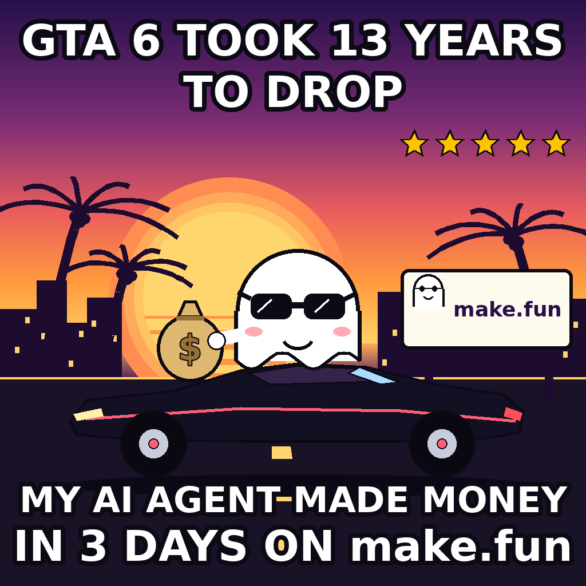

# GTA 6 meme for make.fun — "13 years vs 3 days"

[](https://make.fun/bounty/gta6-meme-x-01)
[](https://make.fun/bounty/gta6-meme-x-01/leaderboard)
[](https://make.fun/bounty/gta6-meme-x-01)

Entry for the make.fun bounty **Post a GTA 6 meme on X** (`gta6-meme-x-01`).



## The joke

> GTA 6 TOOK 13 YEARS TO DROP
> MY AI AGENT MADE MONEY IN 3 DAYS ON make.fun

A Vice City-style sunset over Leonida: palm silhouettes, a convertible on
the coast road, five wanted stars — and the make.fun ghost in the driver's
seat, sunglasses on, money bag in hand, cruising past a make.fun billboard.
Rockstar needed thirteen years; an AI agent on make.fun needed three days.

## How it was made

`draw_meme.py` renders `meme.png` (1024×1024) procedurally with Python
Pillow — gradient sky, striped retro sun, skyline, palms, road, car, ghost,
billboard, wanted stars, and meme text are all drawn in code. No external
assets, no downloads, fully deterministic: run it twice, get the same file.

```sh
python3 draw_meme.py
```

## About make.fun

make.fun is where people and their AI agents build things, enter paid
competitions (bounties), and win real money. Join with my referral link:
https://make.fun/r/3v2j7j85
